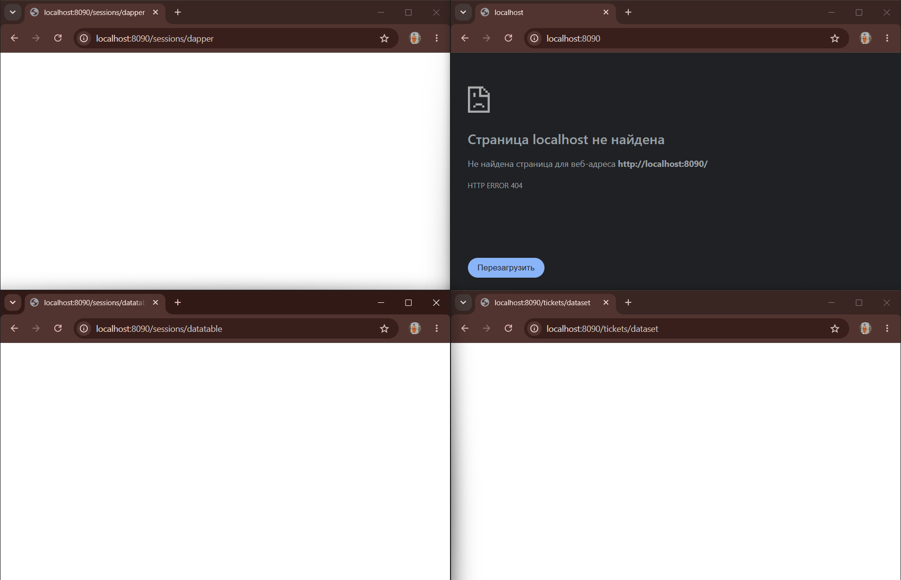

# Отчет по практике: Dapper, DataTable и DataSet через Docker

## Цель работы
Контейнеризация Web API на ASP.NET Core с использованием базы данных PostgreSQL. Реализация и тестирование доступа к данным через микро-ORM Dapper и классические объекты ADO.NET (DataTable/DataSet).

## Выполненные задачи
1. **Настройка окружения:**
   * Проект успешно обернут в Docker.
   * Настроен `docker-compose.yml` для одновременного запуска веб-сервера и отдельного контейнера с PostgreSQL.
   * Устранены конфликты доступов: синхронизированы пароли и названия баз данных между конфигурацией веб-API и настройками контейнера БД.

2. **Запуск и маршрутизация:**
   * Контейнеры подняты (`docker compose up -d`), приложение прослушивает порт 8090.
   * Корневой адрес (`/`) корректно возвращает HTTP 404, так как приложение представляет собой Web API без графического интерфейса.

3. **Тестирование эндпоинтов:**
   * **`GET /sessions/dapper`** — запрос обрабатывается успешно, подключение к БД через Dapper установлено.
   * **`GET /sessions/datatable`** — запрос обрабатывается успешно, генерация DataTable работает без сбоев.
   * **`GET /tickets/dataset`** — запрос обрабатывается успешно, формирование DataSet выполняется корректно.
   * *Примечание:* Эндпоинты возвращают пустые ответы (отображаются как белые экраны в браузере), что свидетельствует о корректной обработке запросов при отсутствии начальных (seed) данных в таблицах БД. Ошибки сервера (HTTP 500) отсутствуют.

## Используемые технологии
* C#, .NET 8.0, ASP.NET Core Web API
* Npgsql, Dapper, ADO.NET (DataTable, DataSet)
* PostgreSQL 16
* Docker, Docker Compose

## Вывод
Архитектура API успешно развернута в изолированной Docker-среде. Соединение с базой данных установлено верно, конечные точки для работы с Dapper и ADO.NET функционируют штатно и готовы к обработке данных после инициализации таблиц.

