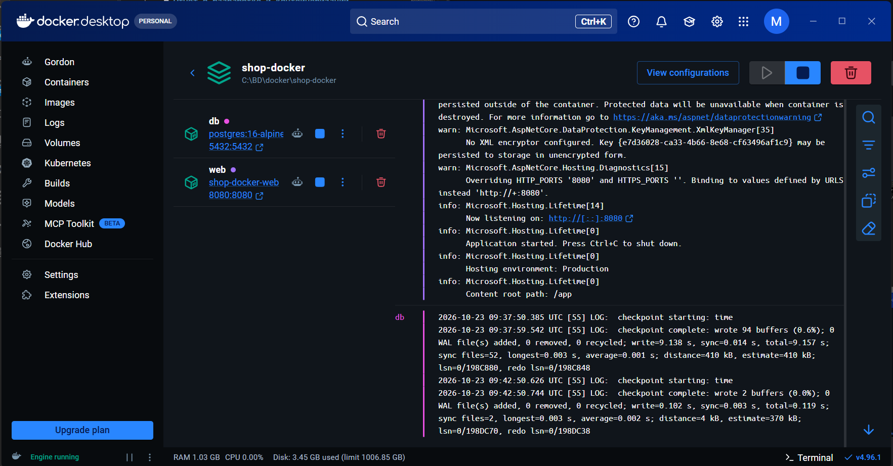
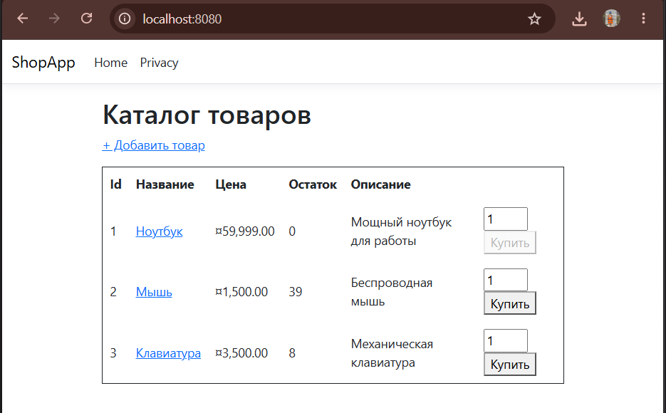

# Отчет о разработке и контейнеризации веб-приложения ShopApp

### Шаг 1. Создание структуры проекта (MVC)
**Описание:**
В соответствии с паттерном MVC была выстроена базовая архитектура приложения. Из проекта удалены избыточные стандартные шаблоны ASP.NET (старые модели и представления ошибок, вызывавшие конфликты). Создана директория `Views/Products/` для пользовательского интерфейса каталога и папка `Data` с классом `DbHelper.cs` для низкоуровневого взаимодействия с PostgreSQL через драйвер `Npgsql`.

### Шаг 2. Устранение ошибок компиляции и кэша
**Описание:**
В процессе сборки решены две проблемы:
1. Исправлено распознавание команд `.NET SDK` локально в PowerShell путем актуализации переменных среды.
2. Устранена критическая ошибка компиляции `Views_Shared__Error_cshtml.g.cs`. Проблема заключалась в кэшировании старых слоев автогенерации кода Razor — для ее решения были принудительно очищены директории `obj/` и `bin/` на стороне хоста.

### Шаг 3. Контейнеризация и Docker-окружение
**Описание:**
Написан многоэтапный `Dockerfile` (multistage build), разделяющий этапы тяжеловесной сборки (SDK) и легковесного запуска (Runtime). Развернут манифест `docker-compose.yml`, который поднимает в единой изолированной сети два контейнера:
1. `web-app` (ASP.NET MVC приложение, проброс на порт 8080).
2. `postgres-db` (СУБД PostgreSQL на базе легковесного образа Alpine Linux).

### Шаг 4. Инициализация базы данных и тестирование
**Описание:**
Настроена автоматическая инициализация БД при старте приложения: код самостоятельно проверяет наличие таблиц, создает их при необходимости и выполняет сидинг тестовых данных (товары: *Ноутбук, Мышь, Клавиатура*). 
Успешно протестирована бизнес-логика: вывод каталога на веб-страницу и транзакционное изменение складских остатков при нажатии кнопки «Купить».

---

**Итоговые характеристики стенда:**
* **Занимаемое место на диске:** ~1.2 – 1.5 ГБ (включая базовые образы SDK, Runtime и Postgres-Alpine).
* **Адрес локального хоста:** [http://localhost:8080](http://localhost:8080)

**Скриншоты запуска:**

