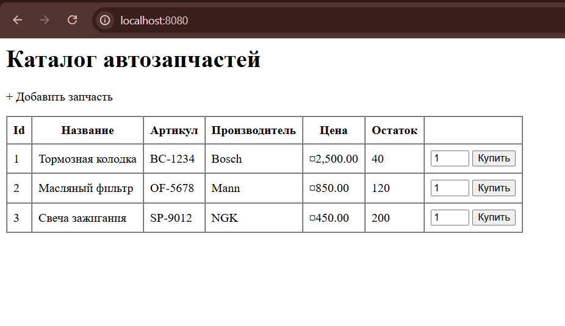
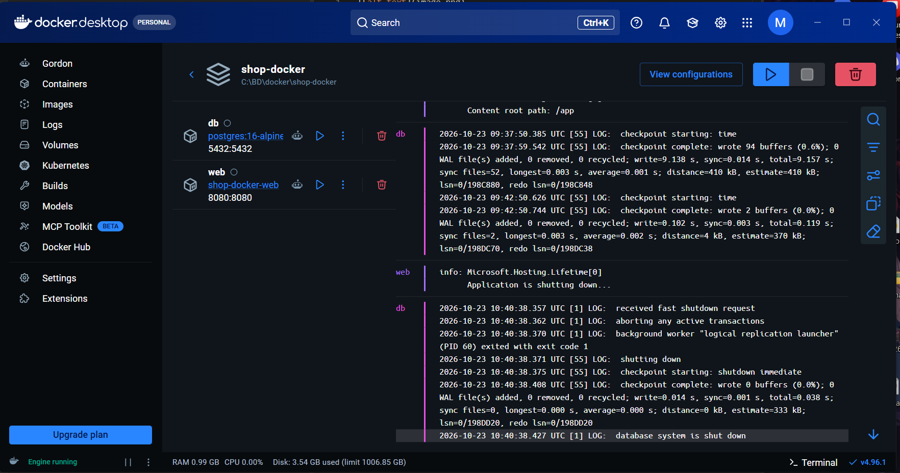

# Отчет о разработке и контейнеризации приложения AutoPartsApp

### Шаг 1. Создание структуры проекта (MVC)
**Описание:**
Развернута базовая архитектура приложения ASP.NET Core MVC в изолированной директории `autoparts-docker`. Созданы директории `Controllers`, `Models`, `Data`, `Views/Parts` и сгенерированы пустые файлы-каркасы. Настроена модель `Part.cs` и подготовлены представления Razor для каталога автозапчастей, просмотра деталей и добавления новых товаров.

### Шаг 2. Реализация слоя доступа к данным (DbHelper.cs)
**Описание:**
С нуля написан класс `DbHelper.cs` для работы с PostgreSQL через провайдер `Npgsql` (ADO.NET). Реализованы методы:
* `Initialize()` — автоматическое создание таблицы `parts` (`CREATE TABLE IF NOT EXISTS`) и сидинг стартовых данных (тормозные колодки, фильтры, свечи).
* `GetAllParts()`, `GetPartById()` — чтение данных через `NpgsqlDataReader` с проверкой на `DBNull`.
* `AddPart()` — добавление записей через параметризованные SQL-запросы для защиты от инъекций.
* `DecreaseStock()` — атомарное списание остатков при покупке с проверкой на наличие товара на складе (`WHERE stock >= @qty`).

### Шаг 3. Контейнеризация и Docker-окружение
**Описание:**
Написан многоэтапный `Dockerfile` (multistage build), разделяющий этапы сборки (SDK) и запуска (Runtime). Настроен манифест `docker-compose.yml`, разворачивающий два контейнера в единой сети:
1. `web` — само приложение (проброс на порт 8080).
2. `db` — база данных (образ `postgres:16-alpine`) с примонтированным томом `pgdata` для сохранения данных. Настроен `healthcheck` (`pg_isready`), чтобы приложение ожидало полной готовности СУБД перед подключением.

### Шаг 4. Сборка и запуск приложения
**Описание:**
Выполнена команда сборки и запуска `docker compose up --build`. Контейнеры успешно подняты, база данных инициализирована, веб-сервер стартовал. Успешно протестирована бизнес-логика: отображение списка запчастей, добавление новых позиций и корректное списание остатков при покупке.

---

**Итоговые характеристики стенда:**
* **Стек технологий:** C#, .NET 8.0, ASP.NET Core MVC, Npgsql, PostgreSQL.
* **Адрес локального хоста:** [http://localhost:8080](http://localhost:8080)

**Скриншоты успешного запуска:**

