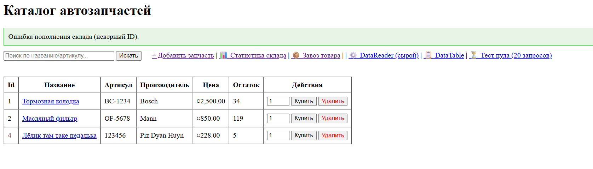
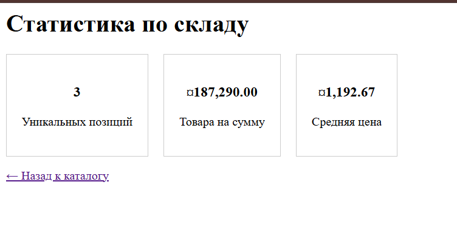
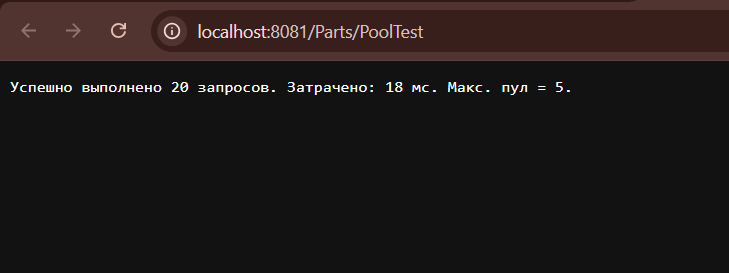

# Отчет по практической работе: Углубленное изучение ADO.NET в ASP.NET Core MVC

**Проект:** Каталог автозапчастей («AutoPartsApp»)
**Стек:** C#, .NET 8.0, ASP.NET Core MVC, Npgsql, PostgreSQL, Docker Compose.
**Окружение:** Контейнеризированное приложение (порты: 8081 -> 8080).

## Цель работы
Реализовать 10 практических задач по работе с базой данных PostgreSQL через ADO.NET, освоить параметризованные запросы, транзакции, асинхронное программирование, обработку специфичных исключений и пулинг соединений.

## Выполненные задачи (1-10)

### 1. Поиск запчастей по названию и артикулу
Реализован метод `SearchParts(string query)`. Использован оператор `ILIKE` для регистронезависимого поиска. Запрос параметризован (параметр `@q` со значением `$"%{query}%"`), что обеспечивает надежную защиту от SQL-инъекций.

### 2. Удаление запчасти с проверкой результата
Добавлен метод `DeletePart(int id)`. Метод возвращает `true` только в случае, если метод `cmd.ExecuteNonQuery()` вернул значение больше `0` (то есть строка действительно была удалена). Добавлено подтверждение удаления на клиенте.

### 3. Статистика по складу одним запросом
Реализован подсчет статистики через агрегатные функции SQL (`COUNT`, `SUM`, `AVG`) и функцию `COALESCE` для обработки `NULL`. Чтение трех колонок выполняется через один `NpgsqlDataReader` (`GetInt32(0)`, `GetDecimal(1)`, `GetDecimal(2)`), без использования `ExecuteScalar`.

### 4. Оформление заказа в транзакции
Добавлена таблица `orders`. Оформление заказа происходит в рамках явной транзакции (`BeginTransaction`). Выполняется чтение остатков, списание (`UPDATE`) и запись в историю покупок (`INSERT`). Объект транзакции передается в каждый `NpgsqlCommand`.

### 5. Массовое поступление товара (с откатом)
Реализован метод `Restock`, обновляющий остатки пачкой. Если при обновлении хотя бы один `ExecuteNonQuery()` возвращает `0` (неверный ID товара), вызывается `tx.Rollback()`, и изменения полностью отменяются.

### 6. «Сырое» чтение через NpgsqlDataReader
Добавлен метод `GetRawParts()`, который обходит таблицу без привязки к модели `Part`. Использованы методы ридера: `FieldCount`, `GetName(i)`, `GetValue(i)` и `IsDBNull(i)` для динамического формирования словаря `Dictionary<string, object?>`.

### 7. Использование DataTable и NpgsqlDataAdapter
Реализован отсоединенный режим доступа к данным. Данные выгружаются в объект `DataTable` с помощью метода `adapter.Fill(dt)`. В представлении таблица строится динамически через перебор `Model.Columns` и `Model.Rows`.

### 8. Асинхронная версия работы с БД
Метод получения списка товаров переписан с использованием асинхронных вызовов: `OpenAsync()`, `ExecuteReaderAsync()`, `ReadAsync()`. В контроллере применен `async Task<IActionResult>` с ключевым словом `await`, что предотвращает блокировку потоков веб-сервера.

### 9. Обработка уникального ограничения (SqlState)
На колонку `article` таблицы `parts` добавлено ограничение `UNIQUE`. При попытке вставки дубликата метод отлавливает `PostgresException` и проверяет код `ex.SqlState == "23505"`. Вместо падения приложения (ошибка 500) пользователю выводится понятное сообщение через `ModelState.AddModelError`.

### 10. Пул соединений (Connection Pooling)
В строку подключения (в `docker-compose.yml`) добавлены параметры `Maximum Pool Size=5; Minimum Pool Size=1`. Написан тестовый эндпоинт, который через `Task.WhenAll` одновременно запускает 20 запросов. 
**Результат:** Все запросы успешно выполняются примерно за 15-20 мс, переиспользуя пул из максимум 5 физических соединений. Блок `using` не закрывает соединение, а корректно возвращает его в пул.

## Результаты тестирования
Все задачи успешно протестированы в браузере (localhost:8081).
* Фильтрация и удаление работают корректно.
* Транзакции откатываются при указании несуществующего ID при массовом завозе (продемонстрировано на скриншоте).

* Статистика выводится на отдельной странице.

* Пул соединений успешно выдерживает параллельную нагрузку.

