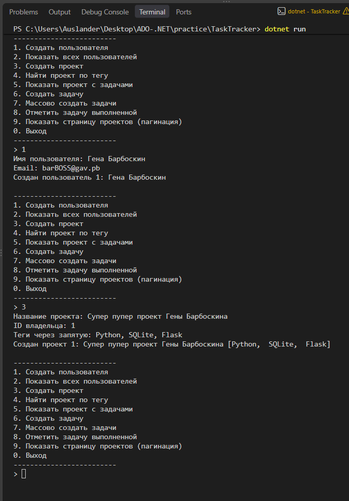

# Отчет по практической работе: Углубленное изучение Dapper и PostgreSQL

**Проект:** Консольный трекер задач («TaskTracker»)
**Стек:** C#, .NET 8.0, Консольное приложение, Dapper (Micro-ORM), Npgsql, PostgreSQL.

## Цель работы

Освоить работу с микро-ORM Dapper в связке с PostgreSQL. Написать типовые и продвинутые SQL-запросы вручную, реализовать репозиторный паттерн и научиться использовать специфичные возможности PostgreSQL (массивы, JSONB, бинарный импорт, транзакции).

## Выполненные задачи и освоенные технологии

В ходе работы было создано консольное приложение с интерактивным меню и реализованы следующие механизмы:

1. **Фабрика соединений и маппинг:**
   * Реализован паттерн `IDbConnectionFactory` для правильного управления подключениями к БД (без статических полей).
   * Включена глобальная настройка `Dapper.DefaultTypeMap.MatchNamesWithUnderscores = true` для автоматического маппинга колонок в формате `snake_case` (PostgreSQL) в свойства `PascalCase` (C#).

2. **Оптимизация запросов через `RETURNING`:**
   * Операции `INSERT`, `UPDATE` и `DELETE` написаны с использованием `RETURNING *`, что позволяет получать измененные строки без дополнительных запросов к БД (экономия round-trip).
   * Реализован `UPSERT` механизм через `ON CONFLICT (id) DO UPDATE`.

3. **Работа со специфичными типами PostgreSQL:**
   * **Массивы:** Запись и чтение строковых массивов (`TEXT[]`) для хранения тегов проекта. Использование оператора `ANY()` для поиска по тегам.
   * **JSONB:** Хранение и чтение метаданных задач и настроек проекта. 

4. **Связи один-ко-многим (Multi-mapping):**
   * Использован метод `QueryAsync<T1, T2, TReturn>` с параметром `splitOn` для маппинга результата `LEFT JOIN` (проекты + задачи) в единый C#-объект со списком дочерних элементов (ручная группировка через словарь).

## Выполнение продвинутых заданий (Advanced Tasks)

Дополнительно в репозитории были внедрены 6 усложненных методов:

1. **Выборка по дате (`GetOverdueAsync`):** Поиск просроченных задач с фильтрацией по дате (`due_date < CURRENT_DATE`).
2. **Обновление JSONB (`UpdateSettingsAsync`):** Изменение части JSON-объекта внутри базы данных без перезаписи всего поля с помощью оператора слияния `||` и явного приведения `::jsonb`.
3. **Keyset-пагинация (`GetPageKeysetAsync`):** Высокопроизводительная постраничная навигация по условию `id > @LastId` (вместо медленного `OFFSET`).
4. **Бинарный импорт COPY (`BulkInsertCopyAsync`):** Сверхбыстрая массовая вставка записей с использованием `BeginBinaryImportAsync` из Npgsql, минуя стандартный `INSERT`.
5. **Массовый Multi-mapping (`GetAllWithTasksAsync`):** Получение списка всех проектов со вложенными задачами одним запросом с корректной склейкой связей.
6. **Транзакции с несколькими таблицами (`CreateWithKickoffAsync`):** Использование `NpgsqlTransaction` для создания проекта и стартовой задачи («Kickoff») в рамках единой неделимой транзакции (с откатом `RollbackAsync` при ошибке).

## Результаты тестирования

Приложение успешно запущено. Подключение к локальной БД `tasktracker` установлено. Через консольное меню были успешно:
* Созданы пользователи (например, "Гена Барбоскин").
* Созданы проекты с привязкой к ID владельца и передачей массивов тегов.
* Оттестирован возврат данных сразу после создания (вывод сгенерированных БД идентификаторов).

